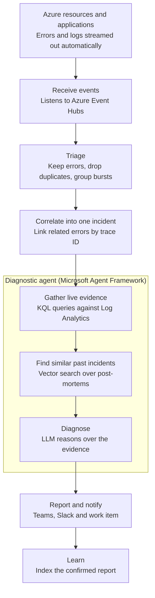

# DevOpsCopilot

**An open-source AI assistant that investigates Azure production incidents and sends on-call engineers the likely cause and suggested fixes.**

DevOpsCopilot diagnoses and recommends only. It never changes anything in production; engineers make every change.

> **Status:** under active development. See [the roadmap](docs/specs/roadmap.md) for phases, milestones and progress.

---

## Why

When something breaks in production, most of the time to resolution goes on working out *what* is wrong: opening several tools, searching logs, and trying to remember whether this has happened before.

DevOpsCopilot does that first investigation automatically. By the time an engineer opens the alert, they already have:

- the errors that belong to the incident, grouped across services,
- live log evidence from around the failure,
- similar past incidents and how they were fixed,
- a likely cause and suggested resolution steps.

The goal is lower mean time to resolution (MTTR), fewer noisy alerts, and post-mortem knowledge that is actually reused.

---

## How it works



1. **Receive events.** A .NET worker consumes error and log events from Azure Event Hubs.
2. **Triage.** Filters for genuine errors, removes duplicates and groups bursts, so hundreds of identical errors become one candidate.
3. **Correlate.** Groups related errors into a single incident using OpenTelemetry trace context, or resource and time window for platform logs.
4. **Gather live evidence.** Runs read-only KQL queries against Log Analytics around the failure.
5. **Find similar past incidents.** Searches historical post-mortems and confirmed reports with hybrid keyword and vector search (RAG) in Azure AI Search.
6. **Diagnose.** An LLM reasons over the evidence and history to produce a likely cause, confidence and suggested fix steps.
7. **Report and notify.** Sends a Microsoft Teams card and/or a Slack message to the on-call channel and creates a work item with the full report.
8. **Learn.** When an engineer resolves the incident and confirms the cause, the report is indexed so future diagnoses can draw on it.

---

## Data sources

DevOpsCopilot needs no code changes in the systems it monitors. It receives two kinds of data through Azure Event Hubs:

| Source | What | How it reaches Event Hubs |
|---|---|---|
| **Infrastructure** | Errors and logs from Azure resources | Azure Monitor diagnostic settings |
| **Applications** | Logs, exceptions and traces emitted through OpenTelemetry | Application Insights diagnostic settings |

The knowledge base starts empty. DevOpsCopilot does not collect historical data in advance; it improves gradually as incidents are resolved and confirmed.

---

## Design principles

- **Diagnose, don't act.** Read-only by design. KQL queries cannot change data, and no production changes are made. This keeps it safe to run and simple to approve.
- **Never invent evidence.** If a data source is unavailable, the report says so instead of guessing.
- **Fixed, bounded investigation.** The agent follows a fixed sequence with a limit on follow-up queries, which keeps it predictable, testable and cost-controlled.
- **Learn only from confirmed causes.** Reports enter the knowledge base only after an engineer confirms or corrects them.
- **Zero-touch onboarding.** New systems are added through configuration (diagnostic settings, enforceable with Azure Policy).
- **Cloud-neutral core.** The workflow depends on interfaces; Azure services are the first implementations.

---

## How we build

### Spec-Driven Development

Every feature starts with a written specification before any code is written. A spec describes:

- the behaviour the feature must deliver and why,
- its inputs and outputs, including the handoff contracts between workflow stages ([docs/pipeline.md](docs/pipeline.md)),
- the rules it must follow (for example, read-only KQL and never inventing evidence),
- clear, testable acceptance criteria.

The spec is the source of truth. Code, tests and AI-agent prompts are written to match it, and if the behaviour needs to change, the spec is updated first, in the same pull request.

### Test-Driven Development

We use TDD on every occasion where it is possible: a failing test is written from the spec's acceptance criteria first, then the code to make it pass, then refactoring with the tests green. This applies to logic with clear right answers, such as event parsing, triage, fingerprinting, correlation, tool safety rules and report formatting.

Where TDD does not fit naturally, we still verify against the spec:

- **AI diagnosis quality** is checked with an evaluation set of staged incidents with known causes, run in CI so prompt changes cannot silently make diagnoses worse.
- **Azure integrations** (Event Hubs, Log Analytics, AI Search, Teams) are covered by integration tests against emulators or test resources, with contract tests at the interface boundaries.

### Architecture and design

- **Clean Architecture (strict).** The code is split into Domain, Application, Infrastructure and a Worker host. Dependencies point inwards only: the Domain knows nothing about Azure, Microsoft Agent Framework or any framework, and every external service is reached through an interface defined in Application and implemented in Infrastructure. Architecture tests enforce the boundaries in CI.
- **Domain-Driven Design (pragmatic).** The model uses the language of incident response. `Incident` is an aggregate that owns its lifecycle; identifiers and small concepts are immutable value objects; lifecycle changes raise domain events. We apply DDD where it clarifies the model, without bounded-context ceremony, event sourcing or CQRS.
- **SOLID.** Small classes with one responsibility, small interfaces, and new channels, sources or clouds added as new implementations rather than edits to existing ones.

### Working rules

- Every change is made on a feature branch named `features/YYYY-MM-DD-name-of-the-feature` (for example `features/2026-10-24-triage-fingerprinting`) and merged through a pull request; nothing is committed directly to `main`.
- Each pull request covers one feature from its spec, and CI (build, tests and evaluation) must pass before merging.
- AI coding agents follow the same rules, described in [AGENTS.md](AGENTS.md).

---

## Tech stack

| Area | Technology |
|---|---|
| Runtime | .NET 10 worker service, containers |
| Orchestration (local) | .NET Aspire |
| Agents | Microsoft Agent Framework |
| Event ingestion | Azure Event Hubs (consumer group and Blob Storage checkpoints) |
| Telemetry | OpenTelemetry, Application Insights, Azure Monitor |
| Live evidence | Log Analytics (KQL) |
| Knowledge search | Azure AI Search (hybrid keyword and vector) |
| LLM | Azure OpenAI |
| Notifications | Microsoft Teams, Slack, Azure DevOps work items |
| Hosting | Azure Container Apps |

---

## Getting started

### Prerequisites

- [.NET 10 SDK](https://dotnet.microsoft.com/download)
- [.NET Aspire CLI](https://learn.microsoft.com/dotnet/aspire/)
- Docker (for the local Event Hubs emulator)
- An Azure subscription, for Log Analytics, Azure AI Search and Azure OpenAI

### Run locally

```bash
git clone https://github.com/chinthaka/devops-copilot.git
cd devops-copilot
aspire run
```

The Aspire AppHost starts the Event Hubs emulator, the DevOpsCopilot worker and the supporting services. When Log Analytics or Azure AI Search are not configured, the corresponding steps report themselves as unavailable rather than inventing results.

### Run tests

```bash
dotnet test
```

---

## Project documents

| Document | Purpose |
|---|---|
| [docs/specs/mission.md](docs/specs/mission.md) | Product mission, audience and boundaries |
| [docs/specs/tech-stack.md](docs/specs/tech-stack.md) | Technologies and services used |
| [docs/specs/roadmap.md](docs/specs/roadmap.md) | Phases, milestones, estimates and risks |
| [docs/pipeline.md](docs/pipeline.md) | Handoff shapes and tool rules between workflow stages |
| `docs/specs/YYYY-MM-DD-feature-name/` | One folder per feature, holding its spec |
| [AGENTS.md](AGENTS.md) | Instructions for AI coding agents working on this repo |

---

## Roadmap

**Phase 1 – Straight-through path:** receive events, gather live evidence, find similar past incidents, write a remediation report, notify Teams, deploy to Azure, and evaluate diagnosis quality.

**Phase 2 – Full incident workflow:** triage, correlation into incidents, incident-based diagnosis, work items, the learning loop, and production readiness.

Out of scope for now: automated remediation, AWS and GCP support, and a direct OpenTelemetry exporter for applications not using Application Insights.

See [the roadmap](docs/specs/roadmap.md) for the full milestone breakdown.

---

## License

[MIT](LICENSE)
